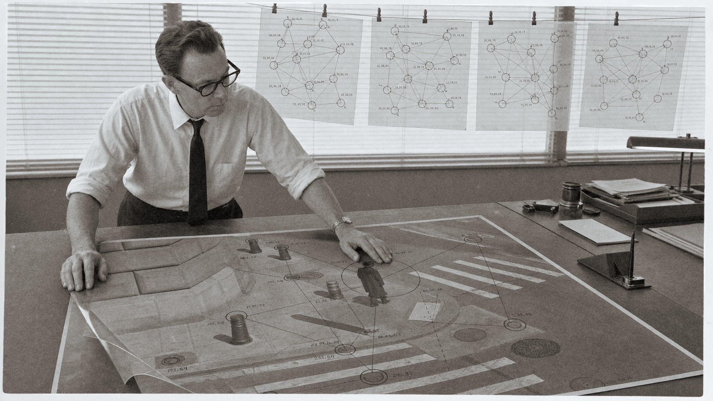
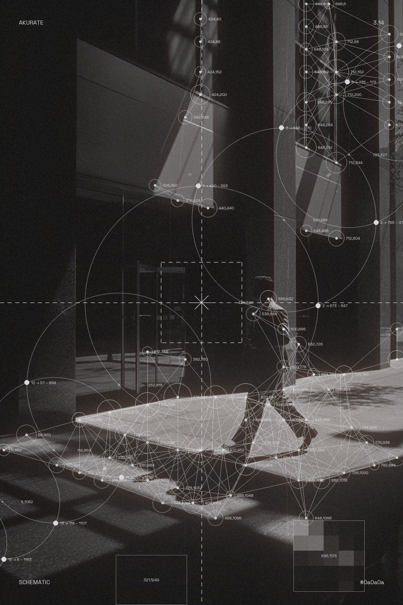

# ComfyUI-Schematic

Turn any image into technical data-art. Four nodes, one visual family: **Schematic Overlay** draws a full annotation apparatus over the photo (detection circles, tangent chains, crosshair frames, pixelation zones), **Schematic Construction** lays a projective-geometry plate over it (two convergent ray pencils, concentric spheres, computed intersections and dense micrographic annotation), **Schematic Voronoi** re-renders the photo as a density-driven wireframe tessellation, tiny bright cells where the image is hot, large faint cells where it is cold, and **Schematic Topographic** draws a complete topographic map sheet over it from a procedural terrain (contours, index contours with elevation labels, hachures, spot heights, benchmarks, campsites, slope arrows, grid, marginalia).



## Schematic Overlay

**Detection**
- Four scoring modes: combined (contrast x brightness deviation), contrast, bright, dark
- Adjustable analysis grid, threshold, circle cap, and minimum spacing between circles

**Shapes**
- Circle or square outlines, with size driven by detection score plus a seeded random jitter

**Connections**
- Straight lines drawn between every pair of circles within a configurable distance

**Chain**
- A tangent chain of circles radiating outward from the canvas center at any angle, with shrinking or growing radius per step
- Optional intersection markers with coordinate labels at every adjacent-circle overlap

**Crosshair**
- Dashed full-canvas cross, dashed centered square frame, and a configurable center asterisk

**Pixelate**
- Mosaic pixelation zones placed by a coordinate string or by a mask (each connected white region becomes a zone), with optional outline and coordinate label

**Frame text**
- Four corner labels, inset from the canvas edge, for a studio-slate look

**Palette**
- Four built-in palettes (whiteOnDark, blackOnLight, goldOnDark, greenOnDark) plus a custom hex background/stroke pair

**Texture**
- An optional texture image screen-blended over the whole canvas. If none is connected and texture opacity is above zero, a seeded procedural grain fills in

**Sizes**
- Match the input image, or crop-to-fill (cover) into five fixed presets: Portrait 3:4, Square, Landscape 16:9, Instagram Story, Poster



## Schematic Construction

A projective-geometry plate drawn over the photograph, which is never altered outside a pixelation zone.

- **Two foci**, each with a convergent ray pencil aimed through detected points and extended across the whole frame. Everything resolves to one of them, so density reads as structure rather than noise.
- **Concentric spheres** about the primary focus, captioned with their radius and ray count
- **Computed intersections** are the annotation engine: rays meeting spheres, including the genuine quadratic intersections where the second focus's rays cut the first focus's spheres. Every label sits on a point the geometry actually produced.
- **Micrographic annotation** throughout: primed point labels, frame-exit labels giving each ray its index and true bearing, a graduated scale, leader callouts, and a running `IDX / ANG / REF` column keyed to the ray table
- **Three weight classes** (datum, construct, fine) so the plate has a hierarchy instead of reading as an even web
- **A label collision resolver** that drops any label it cannot place clearly, which thins annotation exactly where the geometry is densest
- **Pixelation zones** use Overlay's own implementation, placed on computed intersections, with a random size range so patches vary
- **Addressable elements**: every element can be disabled or nudged through the `elements` string, and each group has its own offset widgets. Offsets are normalised canvas fractions, so they survive a resolution change.
- The seed chooses among valid layouts, not just content: foci, sphere radii, which gap carries the lune, and which intersections become zones

## Schematic Voronoi

The photo becomes the density field of a Voronoi tessellation and the mesh becomes the image.

- Three density sources: brightness (pair with the dark palettes), darkness (pair with blackOnLight so tonal values render right side up), and detail (outlines structure)
- `cells` sets the tessellation site count (default 12000); `density_gamma` sets how hard the mesh follows the field
- Ridge intensity is graded by cell size, so dense regions glow and sparse regions fade
- Optional per-cell plate tone (`cell_fill`), seed dots, and a `mesh_weight` stroke multiplier
- The photo itself sits underneath at a low default `image_opacity` (0.2); raise it for a hybrid look, drop it to 0 for pure mesh
- Same palettes, seeded grain texture, frame text, and size presets as Schematic Overlay
- Deterministic: the same seed always produces the same tessellation, every frame of a batch

## Schematic Topographic

A complete topographic map sheet drawn over the photo, every element with its own density, scale and weight controls. The terrain is a seeded procedural landform, so the sheet is an overlay in its own right; the photo is the ground under it.

- Terrain: `terrain_scale`, `terrain_octaves`, `terrain_roughness`, and `terrain_stretch` / `terrain_angle` for flowing ridge-and-valley contours; `height_source` can also derive the terrain from the photo (brightness, darkness, detail) and an optional `height_mask` replaces it entirely
- `contour_text` runs any text along the index contours (or every contour), glyph by glyph, following the line with the line broken under it; `label_unit` adds a suffix such as " m" to the elevation labels
- `smoothing` (Gaussian sigma) sets how calm the terrain is; `elevation_min` / `elevation_max` map the field to metres; `contour_interval` is the contour density (0 to 1000 m at 40 m is 24 lines); every `index_every`-th contour is heavier (`index_weight`) and carries inline elevation labels rotated along the line, with the line broken under each label (`label_size`, `label_spacing`)
- Hachures: short downhill ticks, on depression contours only (the map-sheet convention) or on every contour (`hachure_spacing`, `hachure_length`)
- Slope arrows on a regular grid, pointing downhill, longer where steeper (`arrow_spacing`, `arrow_length`)
- Spot heights at local peaks (triangle) and pits (circle) with their elevation; benchmarks (x cross, "BM" + elevation) at seeded positions kept clear of them (`spot_count`, `spot_min_distance`, `symbol_size`, `benchmark_count`)
- Campsites: scattered CanvasCamp badges pitched on the flatter half of the terrain, clear of the spot heights and benchmarks (`campsites`, `campsite_count`, `campsite_size`; off by default)
- Grid as full lines, edge ticks, ticks plus interior crosses, or dots, with coordinate labels in metres along the bottom and right edges from `map_scale` (`grid_spacing`, `grid_weight`)
- Hypsometric `band_fill`: stepped plate tone between contours, stronger with elevation
- Marginalia: north arrow, a 1-2-5 scale bar from `map_scale`, a "CONTOUR INTERVAL n M" note, one `marginalia_scale` multiplier; `annotations` takes custom call-outs as `x,y:TEXT;x,y:TEXT`
- Overlay's pixelation zones (`pixelate_zones`, `pixelate_mask`, `pixel_size`, `zone_size`, `pixel_stroke`) to alter the photo underneath
- Same palettes, seeded grain texture, four-corner frame text, size presets and three outputs as the siblings
- Deterministic: the same seed always gives the same terrain and benchmarks, every frame of a batch

## Outputs (Overlay and Construction)

- **image**: the full composite, background, photo, pixelation, crosshair, connections, circles, frame text, texture, and chain, all in order.
- **overlay_only**: the same stack without the photo, so the vector layer can be composited elsewhere.
- **overlay_alpha**: a 0 to 1 mask of everywhere a vector element (crosshair, connections, circles, frame text, chain) was drawn, for downstream masking.

## Install

```
cd ComfyUI/custom_nodes
git clone https://github.com/jeremieLouvaert/ComfyUI-Schematic
```

Restart ComfyUI. Both nodes appear under **AKURATE/Schematic**. Schematic Voronoi uses scipy, which ships with ComfyUI itself, so there is nothing extra to install.

## Inputs

| Input | Type | Notes |
|---|---|---|
| `image` | IMAGE | required, source photo |
| `pixelate_mask` | MASK | optional (Overlay, Construction, Topographic), each connected region's centroid becomes a pixelation zone |
| `texture` | IMAGE | optional, screen-blended over the canvas; frame 0 is used for every frame in a batch |
| `texture_mask` | MASK | optional (Schematic Overlay), limits where the texture blend applies; white is full effect, black is none |
| `density_mask` | MASK | optional (Schematic Voronoi), drives seed density instead of the photo |
| `height_mask` | MASK | optional (Schematic Topographic), used as the terrain height instead of the photo |

Key widgets (all carry tooltips in the node itself):

| Widget | Default | Purpose |
|---|---|---|
| `detection_mode` | combined | how blocks are scored for circle placement |
| `block_size` | 16 | analysis grid resolution |
| `threshold` | 30 | minimum score to place a circle |
| `max_circles` | 80 | cap on placed circles |
| `min_distance` | 40 | spacing between circle centers |
| `seed` | 42 | seeds the circle-size jitter and the procedural grain fallback |
| `connection_dist` | 150 | max distance for a connection line, 0 disables |
| `chain_enabled` / `chain_count` | on / 11 | the tangent chain |
| `crosshair_enabled` | on | dashed cross, frame square, and asterisk |
| `pixel_size` / `pixelate_zones` | 16 / "" | pixelation block size and zone list (`x,y;x,y;...`) |
| `palette` / `size_preset` | whiteOnDark / match input | color scheme and canvas size |
| `image_opacity` / `overlay_opacity` / `texture_opacity` | 0.85 / 1.0 / 0.5 | master opacities per layer |

## Credits and clean-room note

Inspired by Yordan Stoyanov's [Brand Assets Generator](https://brand-generator.stoyanov.works/), specifically its Circles mode. This node is a clean-room reimplementation from observed behavior, no source code was copied. Font bundled is Space Grotesk (OFL), not the original tool's typeface. That credit is scoped to Schematic Overlay.

Schematic Construction's apparatus is Euclid-era projective construction and Kepler-era diagram technique, both generic and unencumbered, implemented from its own derivation document. It bundles JetBrains Mono (OFL).

MIT license, see `LICENSE`.
